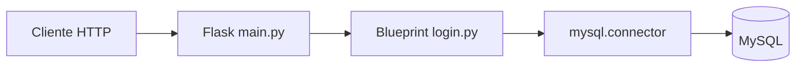

# Laboratorio Python

**CS // SOFTWARE LAB — 03 / Aprendizaje y experimentación**

Recorrido de fundamentos de Python a pequeñas aplicaciones Flask, consultas MySQL y contenedores. Son prácticas independientes, no una aplicación productiva unificada.

## Mapa del repositorio

| Carpeta | Evidencia y alcance |
| --- | --- |
| [clase1](./Python/clase1) | Flask con respuesta inicial y Dockerfile, puerto 5000. |
| [clase2](./Python/clase2) | Variables, operadores, entradas y condicionales. |
| [clase3](./Python/clase3) | Listas, funciones, for y while. |
| [clase4](./Python/clase4) | Flask, blueprint de login y Swagger UI, puerto 5001. |
| [clase5](./Python/clase5) | Flask, consulta de usuarios en MySQL, SQL y Docker Compose. |
| [clase6](./Python/clase6) | Scripts de automatización y Selenium con rutas locales. |
| [Prueba](./Python/Prueba) | Experimentos adicionales. |

## Arquitectura de clase5



Docker Compose describe los contenedores; Swagger UI presenta la especificación estática de la práctica. No se trata de autenticación lista para producción.

## Ejecutar una práctica sencilla

Instalá Python y pip. El Dockerfile de clase1 usa Python 3.9; comprobá compatibilidad con la versión local y las dependencias antiguas antes de instalar. Desde la raíz:

```powershell
cd Python/clase1
python -m venv .venv
.\.venv\Scripts\python.exe -m pip install -r requirements.txt
.\.venv\Scripts\python.exe app.py
```

En Linux/macOS usá `.venv/bin/python`. Abrí `http://localhost:5000/`; el endpoint devuelve el saludo definido en app.py. Alternativa aislada con Docker:

```bash
docker build -t cs-python-clase1 .
docker run --rm -p 127.0.0.1:5000:5000 cs-python-clase1
curl http://localhost:5000/
```

## Clase5: preparación necesaria

Requiere Docker Compose, puerto 5001 y MySQL. Antes de ejecutar, adaptá las dos rutas absolutas de volúmenes del archivo Compose a carpetas propias; configurá datos de desarrollo propios tanto en el servicio MySQL como en login.py. El SQL está en create-table.sql y debe aplicarse a la base local: Compose no lo monta automáticamente como inicialización.

Después de preparar esos puntos, desde `Python/clase5`: `docker compose up --build`. La documentación de la API está en `http://localhost:5001/swagger`. El login recibe JSON con campos user y password. No uses cuentas reales: este ejercicio compara contraseñas en una consulta SQL y no demuestra gestión segura de credenciales.

## Estado y mejoras propuestas

Las dependencias varían por carpeta; no instales un único conjunto para todo el repositorio. Algunos requisitos son antiguos y clase4 debe revisar sus imports y dependencias de base de datos. Los scripts de automatización apuntan a servicios externos: no se ejecutaron ni se usaron cuentas institucionales.

Mejoras futuras: configurar mediante variables de entorno, sustituir rutas absolutas, actualizar dependencias con pruebas, agregar casos de API y separar automatizaciones de sistemas externos. No se ejecutaron servicios ni se generaron capturas de información real durante esta revisión.

---

[CS // Software Lab · Cristhian Storm](https://github.com/CristhianStorm)
